# eMaker Agent

基于 **Java 17、Spring Boot 与 Spring AI** 的知识问答与受控任务编排 Agent。围绕意图路由、混合 RAG、工具调用、多步规划、运行治理与增强记忆，展示从用户问题到可追溯回答的实现过程。

## 展示说明

> **由于企业隐私与业务保密要求，本仓库以天机学堂作为业务框架，展示我实现的 eMaker Agent 的设计与核心能力。** 课程咨询、知识问答、学习规划和预下单等场景用于承载 Agent 的能力演示；企业真实业务场景、内部接口、业务数据、账号凭据和生产配置不在此展示版本中披露。

天机学堂提供课程、搜索、交易、鉴权等基础业务，以及基础 AI 对话、课程工具和会话结构。本项目在此基础上扩展，重点展示 `tj-aigc` 中的 Agent 路由、Skill/Capability、混合检索、MCP 适配、规划执行、证据与增强记忆机制。保留原有 Maven 模块名及 `com.tianji` 包名，便于对照业务载体和源码调用关系。

## 架构

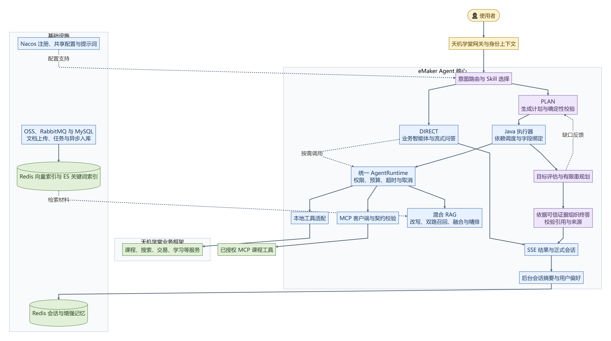

[总体架构](docs/架构设计.md) · [分模块架构与功能流程](#分模块架构与功能流程) · [可编辑 Mermaid 源码](docs/architecture/emaker-agent.mmd) · [SVG 矢量图](docs/architecture/emaker-agent.svg)

## 核心能力

| 能力 | 实现要点 | 代码入口 |
| --- | --- | --- |
| 意图路由与技能选择 | 结构化决策、置信度澄清、技能归属校验、请求级能力白名单 | [RouteAgent](tj-aigc/src/main/java/com/tianji/aigc/agent/RouteAgent.java)、[SkillRegistry](tj-aigc/src/main/java/com/tianji/aigc/skill/SkillRegistry.java) |
| 混合知识检索 | 文档异步入库；问题改写、Redis 向量与 ES BM25 并行召回、RRF 融合、精排与上下文裁剪 | [HybridRagServiceImpl](tj-aigc/src/main/java/com/tianji/aigc/service/impl/HybridRagServiceImpl.java) |
| 本地工具与 MCP | 统一能力契约、输入校验、远端发现与 Schema 核对、结构化结果适配 | [Capability](tj-aigc/src/main/java/com/tianji/aigc/capability/Capability.java)、[McpClientManager](tj-aigc/src/main/java/com/tianji/aigc/mcp/McpClientManager.java) |
| 多步任务编排 | 只读能力规划、依赖和字段绑定校验、就绪步骤分批并行、目标评估及有限重规划 | [AgentLoop](tj-aigc/src/main/java/com/tianji/aigc/runtime/plan/AgentLoop.java)、[AgentExecutor](tj-aigc/src/main/java/com/tianji/aigc/runtime/plan/AgentExecutor.java) |
| 运行治理与可信终答 | 请求身份、预算、超时、取消、脱敏证据快照、终答引用校验和一次格式修复 | [AgentRuntime](tj-aigc/src/main/java/com/tianji/aigc/runtime/AgentRuntime.java)、[FinalAnswerComposer](tj-aigc/src/main/java/com/tianji/aigc/runtime/plan/FinalAnswerComposer.java) |
| 会话与增强记忆 | 正式聊天历史、后台会话摘要、用户明确偏好、版本 CAS 与遗忘标记 | [EnhancedMemoryServiceImpl](tj-aigc/src/main/java/com/tianji/aigc/service/impl/EnhancedMemoryServiceImpl.java) |

## 分模块架构与功能流程

以下图示展开各模块的职责、调用关系和异常分支。图中编号对应本页模块；所有图均提供 PNG、SVG 与可编辑 Mermaid 文件。

| 模块 | 功能 |
| --- | --- |
| [00 模块协作关系](docs/architecture/modules/00-模块协作关系.png) | 展示路由、直接问答、多步编排、受控能力、知识索引和记忆之间的整体关系。 |
| [01 聊天入口与路由分发](docs/architecture/modules/01-聊天入口与路由分发.png) | 根据问题意图、置信度和功能开关，选择业务智能体、技能与执行模式。 |
| [02 技能注册与请求权限](docs/architecture/modules/02-技能注册与请求权限.png) | 启动时注册能力与技能，请求时裁剪能力白名单并建立独立运行上下文。 |
| [03 DIRECT流式问答](docs/architecture/modules/03-DIRECT流式问答.png) | 通过业务智能体、Advisor 和工具回调完成直接问答，输出文本、来源参数与结束事件。 |
| [04 统一运行时与证据](docs/architecture/modules/04-统一运行时与证据.png) | 统一处理能力鉴权、参数校验、预算、超时、取消以及执行证据。 |
| [05 本地工具与MCP](docs/architecture/modules/05-本地工具与MCP.png) | 将本地工具和远端 MCP 工具适配为结构化能力结果，并核验远端输入契约。 |
| [06 知识上传与异步索引](docs/architecture/modules/06-知识上传与异步索引.png) | 通过对象存储、消息队列和任务状态管理完成文档处理与双索引写入。 |
| [07 混合RAG检索与降级](docs/architecture/modules/07-混合RAG检索与降级.png) | 组合问题改写、向量与关键词并行召回、RRF 融合、精排及上下文裁剪。 |
| [08 模型规划与确定性校验](docs/architecture/modules/08-模型规划与确定性校验.png) | 模型生成只读能力计划，程序校验权限、依赖、字段来源和剩余执行预算。 |
| [09 依赖调度与参数绑定](docs/architecture/modules/09-依赖调度与参数绑定.png) | 按依赖调度就绪步骤，将上游真实结构化输出绑定为下游调用参数。 |
| [10 目标评估与可信终答](docs/architecture/modules/10-目标评估与可信终答.png) | 评估证据充分性，必要时有限重规划，并据可信证据生成与校验终答。 |
| [11 正式历史与增强记忆](docs/architecture/modules/11-正式历史与增强记忆.png) | 区分正式历史、会话摘要和用户偏好，以版本比较及遗忘标记控制并发更新。 |
| [12 停止超时与可观测性](docs/architecture/modules/12-停止超时与可观测性.png) | 传播用户取消与超时信号，清理运行资源，并关联各阶段的调用记录。 |

### 00 模块协作关系

展示路由、直接问答、多步编排、受控能力、知识索引和记忆之间的整体关系。

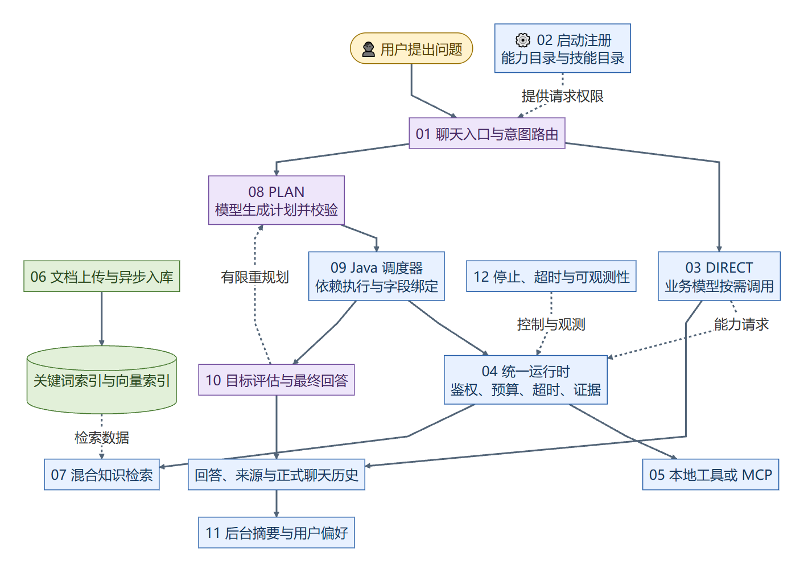

[查看原图](docs/architecture/modules/00-模块协作关系.png) · [SVG](docs/architecture/modules/00-模块协作关系.svg) · [Mermaid](docs/architecture/modules/00-模块协作关系.mmd)

### 01 聊天入口与路由分发

根据问题意图、置信度和功能开关，选择业务智能体、技能与执行模式。

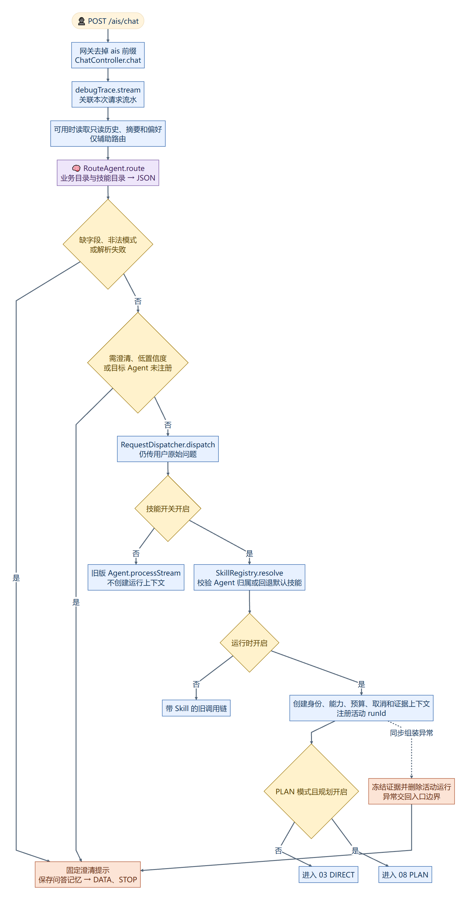

[查看原图](docs/architecture/modules/01-聊天入口与路由分发.png) · [SVG](docs/architecture/modules/01-聊天入口与路由分发.svg) · [Mermaid](docs/architecture/modules/01-聊天入口与路由分发.mmd)

### 02 技能注册与请求权限

启动时注册能力与技能，请求时裁剪能力白名单并建立独立运行上下文。

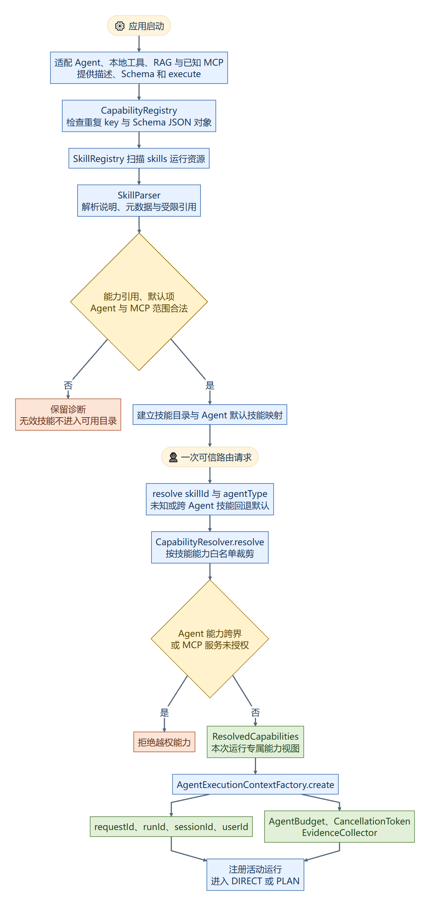

[查看原图](docs/architecture/modules/02-技能注册与请求权限.png) · [SVG](docs/architecture/modules/02-技能注册与请求权限.svg) · [Mermaid](docs/architecture/modules/02-技能注册与请求权限.mmd)

### 03 DIRECT流式问答

通过业务智能体、Advisor 和工具回调完成直接问答，输出文本、来源参数与结束事件。

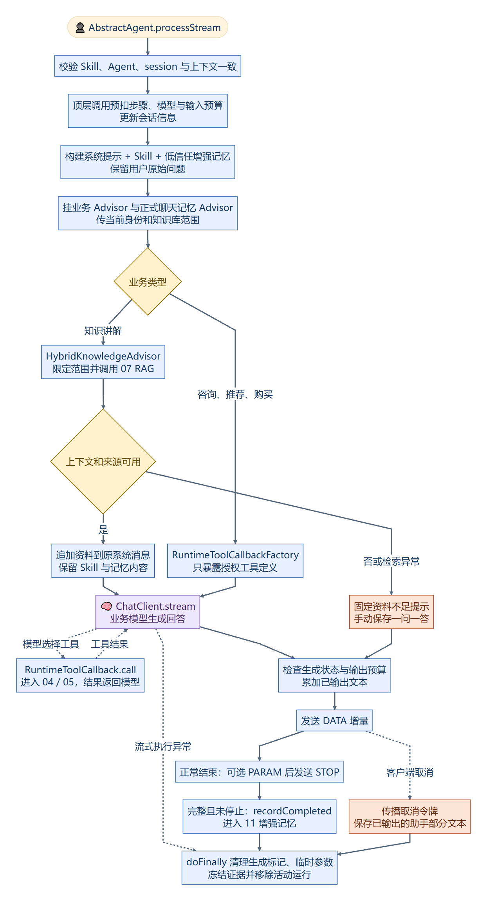

[查看原图](docs/architecture/modules/03-DIRECT流式问答.png) · [SVG](docs/architecture/modules/03-DIRECT流式问答.svg) · [Mermaid](docs/architecture/modules/03-DIRECT流式问答.mmd)

### 04 统一运行时与证据

统一处理能力鉴权、参数校验、预算、超时、取消以及执行证据。

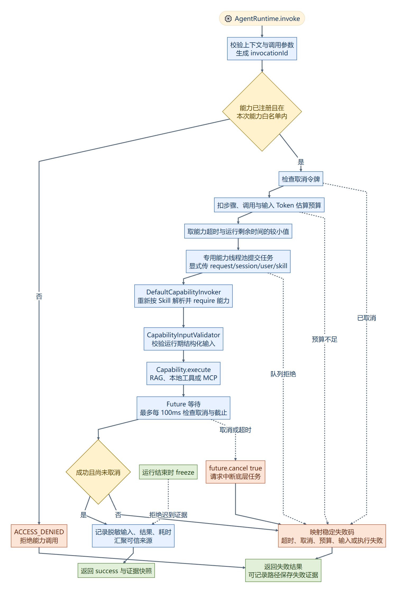

[查看原图](docs/architecture/modules/04-统一运行时与证据.png) · [SVG](docs/architecture/modules/04-统一运行时与证据.svg) · [Mermaid](docs/architecture/modules/04-统一运行时与证据.mmd)

### 05 本地工具与MCP

将本地工具和远端 MCP 工具适配为结构化能力结果，并核验远端输入契约。

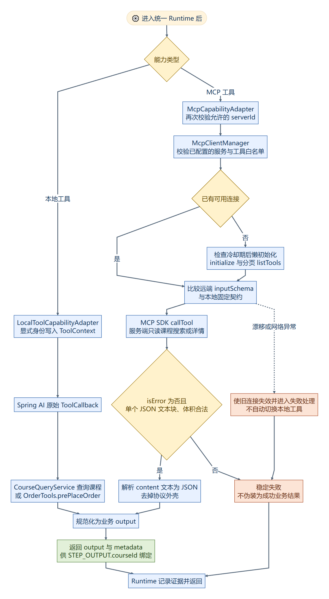

[查看原图](docs/architecture/modules/05-本地工具与MCP.png) · [SVG](docs/architecture/modules/05-本地工具与MCP.svg) · [Mermaid](docs/architecture/modules/05-本地工具与MCP.mmd)

### 06 知识上传与异步索引

通过对象存储、消息队列和任务状态管理完成文档处理与双索引写入。

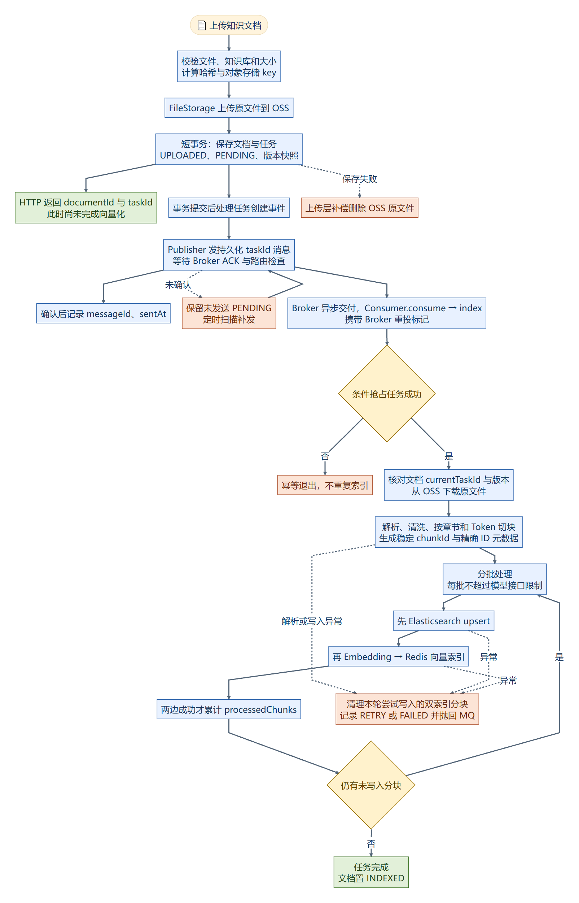

[查看原图](docs/architecture/modules/06-知识上传与异步索引.png) · [SVG](docs/architecture/modules/06-知识上传与异步索引.svg) · [Mermaid](docs/architecture/modules/06-知识上传与异步索引.mmd)

### 07 混合RAG检索与降级

组合问题改写、向量与关键词并行召回、RRF 融合、精排及上下文裁剪。

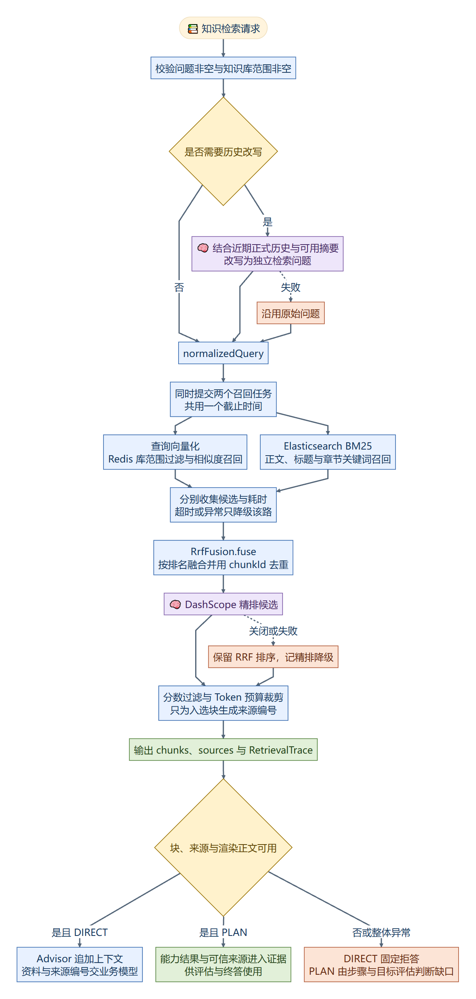

[查看原图](docs/architecture/modules/07-混合RAG检索与降级.png) · [SVG](docs/architecture/modules/07-混合RAG检索与降级.svg) · [Mermaid](docs/architecture/modules/07-混合RAG检索与降级.mmd)

### 08 模型规划与确定性校验

模型生成只读能力计划，程序校验权限、依赖、字段来源和剩余执行预算。

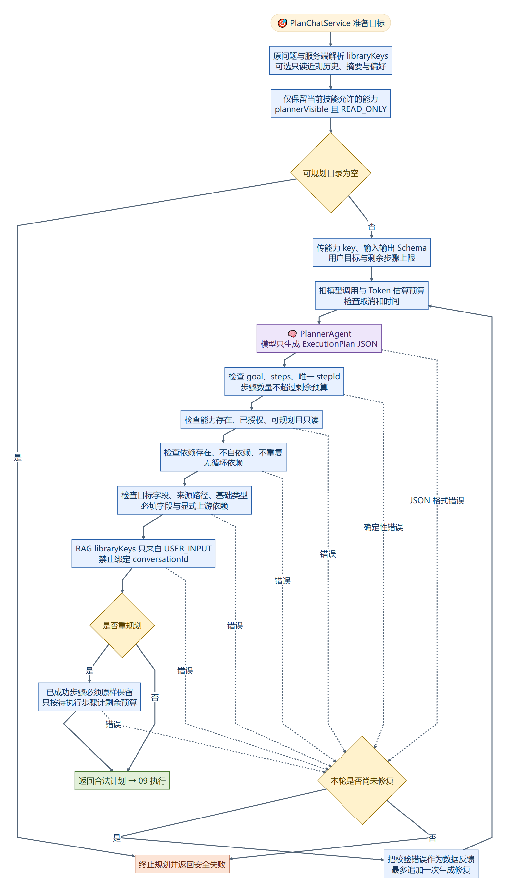

[查看原图](docs/architecture/modules/08-模型规划与确定性校验.png) · [SVG](docs/architecture/modules/08-模型规划与确定性校验.svg) · [Mermaid](docs/architecture/modules/08-模型规划与确定性校验.mmd)

### 09 依赖调度与参数绑定

按依赖调度就绪步骤，将上游真实结构化输出绑定为下游调用参数。

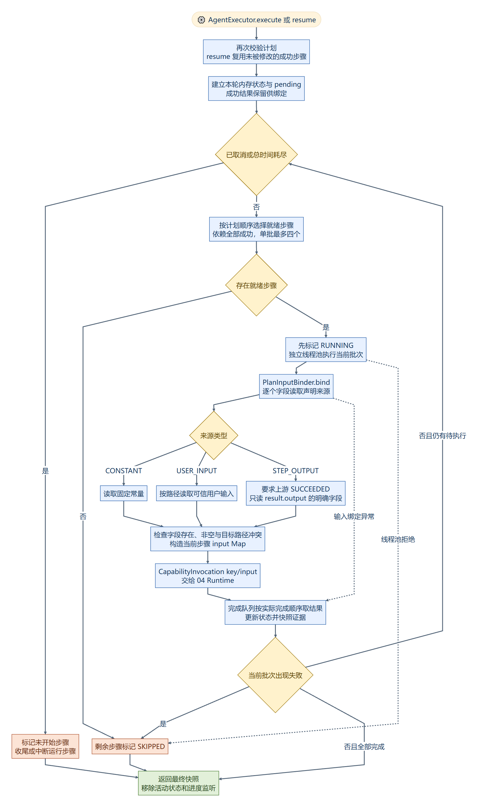

[查看原图](docs/architecture/modules/09-依赖调度与参数绑定.png) · [SVG](docs/architecture/modules/09-依赖调度与参数绑定.svg) · [Mermaid](docs/architecture/modules/09-依赖调度与参数绑定.mmd)

### 10 目标评估与可信终答

评估证据充分性，必要时有限重规划，并据可信证据生成与校验终答。

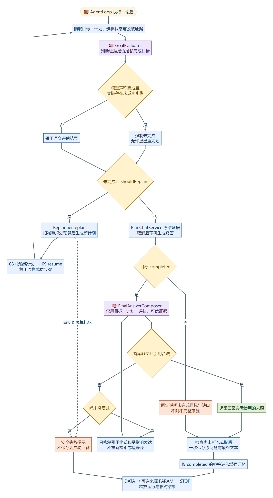

[查看原图](docs/architecture/modules/10-目标评估与可信终答.png) · [SVG](docs/architecture/modules/10-目标评估与可信终答.svg) · [Mermaid](docs/architecture/modules/10-目标评估与可信终答.mmd)

### 11 正式历史与增强记忆

区分正式历史、会话摘要和用户偏好，以版本比较及遗忘标记控制并发更新。

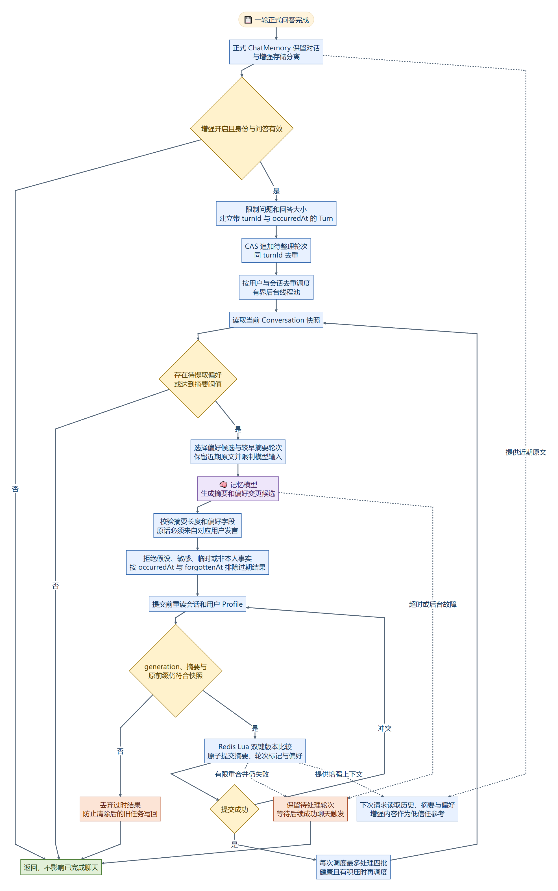

[查看原图](docs/architecture/modules/11-正式历史与增强记忆.png) · [SVG](docs/architecture/modules/11-正式历史与增强记忆.svg) · [Mermaid](docs/architecture/modules/11-正式历史与增强记忆.mmd)

### 12 停止超时与可观测性

传播用户取消与超时信号，清理运行资源，并关联各阶段的调用记录。

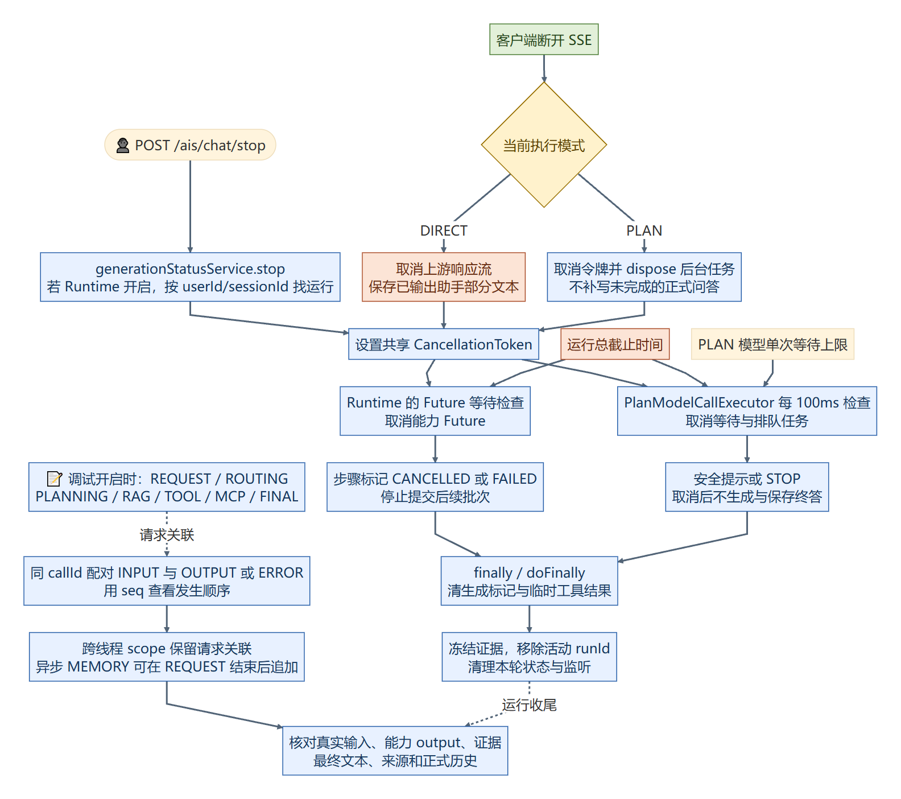

[查看原图](docs/architecture/modules/12-停止超时与可观测性.png) · [SVG](docs/architecture/modules/12-停止超时与可观测性.svg) · [Mermaid](docs/architecture/modules/12-停止超时与可观测性.mmd)

## 目录

```text
eMaker-agent/
├── tj-aigc/                    # Agent 核心实现与运行 Skill、AI 表结构
├── tj-api/、tj-common/         # 服务调用契约与公共基础组件
├── tj-auth/、tj-gateway/       # 业务身份与网关
├── tj-course/、tj-search/      # 课程与检索业务载体
├── tj-trade/、tj-pay/ 等       # 原框架其余业务模块
├── docs/architecture/          # 总体与分模块架构图：PNG、SVG、Mermaid
├── config/nacos/               # 公开演示共享配置与示例提示词
├── config/keys/                # 自行生成的演示证书说明
├── examples/                   # 功能接口请求示例
├── .env.example                # 空凭据与本机地址示例
└── pom.xml                     # 保留完整 Maven 多模块结构
```

## 项目文档

- [架构设计](docs/架构设计.md)：模块职责、核心链路与设计取舍。
- [分模块架构与功能流程](#分模块架构与功能流程)：各模块的功能、调用关系与异常分支。
- [构建与配置](docs/运行指南.md)：构建要求、运行依赖与配置方式。

## 构建与运行准备

需要 **JDK 17、Maven 3.6+**。在根目录执行：

```shell
mvn -DskipTests compile
```

运行时还需自行准备 Nacos、MySQL、支持向量检索的 Redis、Elasticsearch 7、RabbitMQ、OSS 和模型账号，并配置演示登录身份与业务数据。这里提供代码及配置起点，**不包含完整业务数据库、原 Nacos 导出或可直接连接的企业环境**。

`.env.example` 不会被 Spring Boot 自动加载；请把需要的值注入进程环境或部署配置。PLAN 与 MCP 默认关闭，开启条件见运行指南。

## 当前边界

- PLAN 仅规划已授权的只读能力；购买场景中的预下单不代表支付或扣款。
- 步骤状态为进程内状态，支持同次运行的重规划续跑，未实现跨进程持久化 DAG 恢复。
- 检索来源、工具业务字段和用户偏好分别处理，不把它们混称为同一种知识证据。
- 仓库用于展示项目代码、架构与功能，不包含企业生产环境与业务数据。

基础框架与第三方组件的来源说明见 [THIRD_PARTY_NOTICES.md](THIRD_PARTY_NOTICES.md)。
